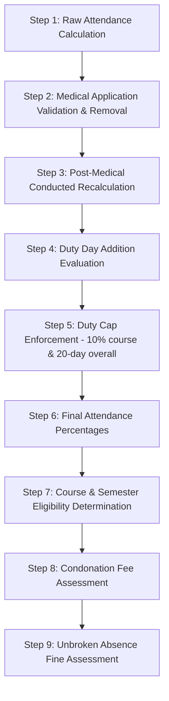

# PS-068 – Student Attendance and Condonation / Eligibility Engine
## Technical Architecture & Design Document

---

## 1. Project Overview

The **PS-068 Student Attendance and Condonation / Eligibility Engine** is a high-performance, deterministic, command-file-driven backend system implemented in **Python 3.10+**. It implements a complete institutional attendance management pipeline without external API dependencies or GUI wrappers.

### Project Scale & Operational Target
- **300 Students** enrolled across **4 Sections** (`A`, `B`, `C`, `D`).
- **24 Courses** (Theory and Laboratory courses).
- **16-Week Academic Calendar** (~70 working days, exam windows, holidays, working Saturdays).
- **~140,000 Attendance Period Records** (designed for scales of 40,000–200,000+ records).
- **~60 Condonation Applications** (Medical, Sports, NCC/NSS, Placement, Bereavement).
- **Single Master Command File** (`command.txt`) executing end-to-end workflows.
- **Evaluation Agnostic**: Zero hardcoded student IDs, dates, or sample constants; fully compatible with hidden institutional evaluation datasets.

---

## 2. System Architecture & Component Hierarchy

```text
                               ┌────────────────────────────────┐
                               │          command.txt           │
                               └───────────────┬────────────────┘
                                               │
                                               ▼
                               ┌────────────────────────────────┐
                               │         CommandParser          │
                               └───────────────┬────────────────┘
                                               │ Dispatches
                                               ▼
                               ┌────────────────────────────────┐
                               │        main.py Handlers        │
                               └───────┬───────────────┬────────┘
                                       │               │
                  ┌────────────────────┘               └────────────────────┐
                  ▼                                                         ▼
       ┌─────────────────────┐                                   ┌─────────────────────┐
       │     DataLoader      │                                   │      AppState       │
       │(Strict CSV Parsers) │                                   │  (State Cache/Dirty)│
       └──────────┬──────────┘                                   └──────────┬──────────┘
                  │                                                         │
                  ├───────────────────────────────┬─────────────────────────┤
                  ▼                               ▼                         ▼
       ┌─────────────────────┐         ┌─────────────────────┐   ┌─────────────────────┐
       │   StudentManager    │         │    CourseManager    │   │   CalendarManager   │
       │ (O(1) Section Index)│         │(O(1) Lab/Theory Map)│   │ (Freeze Date & Days)│
       └─────────────────────┘         └─────────────────────┘   └─────────────────────┘
                  │                                                         │
                  └───────────────────────┬─────────────────────────────────┘
                                          ▼
                               ┌─────────────────────┐
                               │  AttendanceManager  │
                               │(Multi-Index Engine) │
                               └──────────┬──────────┘
                                          │
                                          ▼
                               ┌─────────────────────┐
                               │AttendanceCalculator │
                               │(Base Rules R1 - R9) │
                               └──────────┬──────────┘
                                          │
                                          ▼
                               ┌─────────────────────┐
                               │  CondonationEngine  │
                               │ (9-Step Pipeline)   │
                               └──────────┬──────────┘
                                          │
                  ┌───────────────────────┴────────────────────────┐
                  ▼                                                ▼
       ┌─────────────────────┐                          ┌─────────────────────┐
       │   WarningManager    │                          │   ReportGenerator   │
       │(Monthly Run 1, 2, 3)│                          │ (11 Filtered CSVS)  │
       └─────────────────────┘                          └─────────────────────┘
```

---

## 3. Data Structures & In-Memory Indexing

To avoid full dataset scans ($O(N \cdot M)$ complexity bottlenecks), all managers construct indexed structures upon loading:

| Component | In-Memory Index | Data Type | Complexity / Purpose |
| :--- | :--- | :--- | :--- |
| `StudentManager` | `_students` | `Dict[str, Student]` | $O(1)$ Student retrieval by ID |
| `StudentManager` | `_by_section` | `Dict[str, List[Student]]` | $O(1)$ Section student retrieval |
| `CourseManager` | `_courses` | `Dict[str, Course]` | $O(1)$ Course retrieval |
| `CourseManager` | `_for_section` | `Dict[str, List[Course]]` | $O(1)$ Courses applicable to section |
| `CalendarManager` | `_calendar` | `Dict[date, CalendarEntry]` | $O(1)$ Date classification |
| `CalendarManager` | `_working_days` | `List[date]` | Chronologically sorted working day cache |
| `AttendanceManager` | `_by_student_course` | `Dict[Tuple[str, str], List[Record]]` | $O(1)$ Bucket lookup for `(student_id, course_id)` |
| `AttendanceManager` | `_by_student_date` | `Dict[Tuple[str, date], List[Record]]` | $O(1)$ Bucket lookup for daily streak calculations |
| `AttendanceManager` | `_od_index` | `Dict[Tuple[str, date], Set[str]]` | $O(1)$ OD approval lookup with wildcard `*` support |
| `CondonationEngine` | `_placement_index` | `Dict[date, Set[str]]` | $O(1)$ Valid placement attendee lookup |
| `CondonationEngine` | `_approved_apps` | `Dict[str, List[Application]]` | $O(1)$ Approved condonation applications by student |
| `WarningManager` | `_issued_levels` | `Dict[str, Set[WarningLevel]]` | Deduplication tracking per semester |
| `WarningManager` | `_below_75_months` | `Dict[str, List[Tuple[int, float]]]` | Tracking consecutive months $<75\%$ |

---

## 4. Input & Output File Formats

### 4.1 Input CSV Specifications (`data/`)
1. **`students.csv`**: `student_id,name,programme,semester,section,admission_date,is_lateral`
2. **`courses.csv`**: `course_id,course_name,weekly_periods,is_lab,section`
3. **`academic_calendar.csv`**: `calendar_date,day_type,replaces_day`
4. **`timetable.csv`**: `section,day,period_no,course_id,start_time,end_time`
5. **`attendance.csv`**: `record_id,student_id,course_id,record_date,period_no,status,arrival_time,faculty_id`
6. **`condonation_applications.csv`**: `application_id,student_id,course_id,reason,start_date,end_date,description,status,approved_by,approved_on,medical_cert_ref,submitted_on`
7. **`od_approvals.csv`**: `od_id,student_id,course_id,od_date,reason,approved_by`
8. **`placement_calendar.csv`**: `event_id,event_date,company,student_ids`

### 4.2 Output Standardized Reports (`reports/`)
1. **Attendance Register** (`attendance_register_sec*.csv`): Detailed period audit logs.
2. **Course-Wise Attendance Report** (`course_wise_attendance_sec*.csv`): Conducted, present, absent, percentages per course.
3. **Overall Attendance Report** (`overall_attendance_sec*.csv`): Aggregate percentages and eligibility tags.
4. **Eligibility List** (`eligibility_sec*.csv`, `eligibility_all.csv`): Official end-of-semester exam permit list.
5. **Shortage List** (`shortage_sec*.csv`): Course-level attendance shortages ($<75\%$).
6. **Condonation Application Status Report** (`condonation_status_report.csv`): Comprehensive audit of all condonation applications.
7. **Condonation Fee Report** (`condonation_fee_report.csv`): Course-wise fine assessment (₹500 / ₹1,000).
8. **Absence Fine Report** (`absence_fine_report.csv`): Breakdown of unbroken absence streaks and fines assessed.
9. **Warning Letters Summary** (`warning_letters_summary.csv`): Semester warning letter log.
10. **Parent Meeting Flags** (`parent_meeting_flags.csv`): Escalation roster for students $<75\%$ for 3 months.
11. **Attendance Correction Audit Log** (`attendance_correction_audit_log.csv`): Immutable audit trail of administrative corrections.

---

## 5. Comprehensive Business Rules (BR-01 through BR-25)

### Fundamental Attendance Rules
- **BR-01 (Conducted Period Verification)**: An attendance record is counted as a conducted period if and only if `faculty_id` is recorded and non-empty. Unrecorded periods are discarded.
- **BR-02 (Holiday Invalidation)**: Records marked on institutional holidays (`day_type == HOLIDAY`) or Sundays are completely ignored.
- **BR-03 (Working Saturday Substitution)**: Working Saturdays execute the timetable of the replaced day (`replaces_day`).
- **BR-04 (Laboratory Period Weighting)**: Laboratory sessions count as 2 periods per timetable slot (`weight = 2`). Theory courses count as 1 period (`weight = 1`).
- **BR-05 (Late Grace Window)**: When status is `LATE`, arrival within 10 minutes (`arrival_time <= slot_start + 10 min`) counts as `PRESENT`; arrival after 10 minutes counts as `ABSENT`.
- **BR-06 (On-Duty Validation)**: Status `OD` counts as `PRESENT` only when an approved OD entry exists in `od_approvals.csv` or a matching `PlacementEvent` exists; otherwise counts as `ABSENT`.
- **BR-07 (Admission Date Rule)**: For regular students, records prior to `semester_start` are ignored. For lateral-entry students (`is_lateral == TRUE`), records prior to `max(semester_start, admission_date)` are ignored.
- **BR-08 (Display Precision)**: Displayed percentages are rounded to 2 decimal places using `ROUND_DOWN` to avoid floating-point rounding errors.

### Condonation Rules
- **BR-09 (Medical Period Removal)**: Approved medical leave removes periods from both conducted and present counts.
- **BR-10 (Medical Cap)**: Medical condonation is capped at $\lfloor 15\% \times \text{conducted periods} \rfloor$ per course.
- **BR-11 (Medical Submission Deadline & Proof)**: Medical applications require a non-empty `medical_cert_ref` and submission within 7 days of `end_date`. Later submissions are rejected as `REJECTED_LATE`.
- **BR-12 (Sports / NCC / NSS Additions)**: Approved duty days are credited as present for absent periods.
- **BR-13 (Overall Duty Cap)**: Sports/NCC/NSS duty is capped at an aggregate maximum of 20 duty days per semester across all courses.
- **BR-14 (Course Duty Cap)**: Sports/NCC/NSS duty additions are capped at $\lfloor 10\% \times \text{post-medical conducted periods} \rfloor$ per course.
- **BR-15 (Placement Duty Qualification)**: Placement duty is available strictly to final-year students (`semester >= 7`). The duty date must match an official drive in `placement_calendar.csv`. Placement duty carries no cap.
- **BR-16 (Bereavement Leave)**: Bereavement leave is granted up to a maximum of 5 consecutive calendar days, strictly once per semester. Application must be submitted within 3 days. No medical proof is required.

### Eligibility, Fees & Fines
- **BR-17 (Course Eligibility Thresholds)**:
  - $\ge 75.00\% \implies \text{ELIGIBLE}$
  - $65.00\% - 74.99\% \implies \text{CONDONABLE}$
  - $< 65.00\% \implies \text{DETAINED}$
- **BR-18 (Third Condonable Course Detention)**: A student can condone at most 2 courses per semester. If 3 or more courses fall in the $65.00\%-74.99\%$ range, the third and subsequent condonable courses become `DETAINED`.
- **BR-19 (Semester Detention Threshold)**: A student with 3 or more `DETAINED` courses (or an overall final attendance $<65.00\%$) is classified as whole-semester `DETAINED`.
- **BR-20 (Condonation Fee Structure)**:
  - $70.00\% - 74.99\% \implies ₹500$ per course.
  - $65.00\% - 69.99\% \implies ₹1,000$ per course.
  - Capped at maximum 2 condonable courses (maximum fee ₹2,000). Detained courses carry ₹0 fee.
- **BR-21 (Absence Fine Assessment)**: Unbroken stretches of 3 or more full working days absent without approved leave incur a fine of ₹100 per day starting from the 3rd day (`fine = ₹100 * (streak_length - 2)`). Intervening institutional holidays break the absence streak. Total absence fine is capped at ₹2,000 per semester.

### Warning Letters & Freeze Protocol
- **BR-22 (Warning Letter Tiers)**:
  - Cumulative attendance $< 80.00\% \implies \text{FIRST\_WARNING}$
  - Cumulative attendance $< 75.00\% \implies \text{SECOND\_WARNING}$ (with mandatory parent copy).
- **BR-23 (Warning Deduplication)**: Each warning level is issued at most once per student per semester.
- **BR-24 (Parent Meeting Escalation)**: A student whose attendance remains $<75.00\%$ across 3 consecutive monthly evaluations receives an escalated `PARENT_MEETING` flag.
- **BR-25 (Attendance Freeze Date & Principal Authorization)**:
  - Attendance freezes 7 days before examination start (`freeze_date = exam_start - 7 days`).
  - Applications submitted after the freeze date are rejected as `REJECTED_FROZEN`. Submissions on the freeze date are accepted.
  - Post-freeze attendance modifications require explicit authorization from the Principal (`auth == "PRINCIPAL"`). All corrections are recorded in the immutable audit log.

---

## 6. Execution Order & Pipeline



1. **Step 1 (Raw Calculation)**: Compute unadjusted conducted and attended periods for every registered course applying timetable weights and OD/Late rules.
2. **Step 2 (Medical Removal)**: Validate approved medical requests against certificate and deadline requirements. Cap periods at $\lfloor 15\% \times \text{raw conducted} \rfloor$. Deduct removed periods from conducted and present counts.
3. **Step 3 (Post-Medical Baseline)**: Establish `post_medical_conducted` as the baseline denominator for duty caps.
4. **Step 4 (Duty Addition)**: Calculate absent periods eligible for Sports, NCC/NSS, Placement, and Bereavement leave.
5. **Step 5 (Duty Cap Evaluation)**: Clip Sports/NCC/NSS additions to the 20-day semester duty cap and the 10% post-medical course cap.
6. **Step 6 (Final Percentages)**: Calculate final course-wise and overall attendance percentages using exact integer and Decimal representation.
7. **Step 7 (Eligibility Determination)**: Evaluate course thresholds. Sort condonable courses; retain top 2 as `CONDONABLE` and convert 3rd+ to `DETAINED`. If detained courses $\ge 3$, mark semester status as `DETAINED`.
8. **Step 8 (Fee Assessment)**: Apply ₹500 or ₹1,000 fee strictly to the up to 2 approved `CONDONABLE` courses.
9. **Step 9 (Fine Assessment)**: Scan working days for unbroken full-day unexcused absences. Apply ₹100/day fine starting from day 3 (capped at ₹2,000).

---

## 7. Warning Letters & Escalation Workflow

The `WarningManager` executes monthly evaluations at scheduled intervals (Month 1, Month 2, Month 3):
- **Level Deduplication**: A student receiving `FIRST_WARNING` in Month 1 will not receive a duplicate `FIRST_WARNING` in Month 2 if attendance remains in the 75–80% band.
- **Escalation**: If attendance drops below 75% in Month 2, the student transitions to `SECOND_WARNING` with an official Parent Copy.
- **Parent Meeting Flag**: If attendance remains $<75\%$ across all 3 monthly evaluations, a `ParentMeetingFlag` is raised and exported to `parent_meeting_flags.csv`.

---

## 8. Freeze Logic & Administrative Audit Trail

```text
Semester Start                      Freeze Date (Exam - 7 Days)     Exam Start
───────┼────────────────────────────────────────┼───────────────────────┼──────▶
       │ Normal Condonation Accepted            │ All New Condonations  │
       │ Normal Attendance Recorded             │ REJECTED_FROZEN       │
       │                                        │ Corrections Require   │
       │                                        │ PRINCIPAL Auth        │
```

- Any call to `PRINCIPAL_CORRECTION` checks whether the target date is post-freeze. If post-freeze and `authorized_by` does not contain `"PRINCIPAL"`, the system raises `PermissionError`.
- Every correction appends an entry to `AttendanceCorrectionLog`:
  `[log_id, timestamp, student_id, course_id, record_date, period_no, old_status, new_status, authorized_by, reason, is_post_freeze]`

---

## 9. Edge-Case Handling & Robustness

All 17 critical edge cases are tested in `tests/test_edge_cases.py`:
1. **75.00% vs 74.99%**: Tested with 75/100 (`ELIGIBLE`, fee ₹0) vs 7499/10000 (`CONDONABLE`, fee ₹500).
2. **Late Arrival at Exactly 10 vs 11 Minutes**: 09:10 marked `PRESENT`; 09:11 marked `ABSENT`.
3. **Fractional Medical Caps**: 45 conducted periods with 15% cap $\implies \lfloor 6.75 \rfloor = 6$ periods removed.
4. **Medical Overlap with Holiday & Working Saturday**: Holiday periods excluded; Working Saturday replaces-day timetable periods credited.
5. **3 Detained Courses After Condoning 2 Others**: 2 condoned + 3 detained $\implies$ semester `DETAINED`.
6. **Lateral Entry Day 30 vs Day 31**: Day 30 absent period excluded; Day 31 present period counted.
7. **Absence Streak Interrupted by Holiday**: Working day absent $\to$ Holiday $\to$ Working day absent does not form an unbroken streak of 3 days.
8. **Condonation Submitted on Freeze Date**: Submitted on `freeze_date` accepted; submitted on `freeze_date + 1` marked `REJECTED_FROZEN`.
9. **Third Condonable Course Detention**: 3 courses at 72% $\implies$ 2 condoned, 1 detained.
10. **Placement on Invalid Date**: Placement application on dates outside placement calendar rejected.
11. **Post-Freeze Principal Correction**: Unauthorized attempts fail with `PermissionError`; authorized modifications update audit log.
12. **Multiple Monthly Warning Runs**: Full deduplication of warning letters across runs 1, 2, 3; 3rd month triggers `ParentMeetingFlag`.
13. **Duplicate Commands / Re-registration**: Safe updates without state corruption.
14. **Missing Input Files**: Clear `FileNotFoundError` raised with file path.
15. **Malformed CSV Records**: Strict `ValueError` surfaced immediately.
16. **Empty Attendance Datasets**: Clean $0.0\%$ percentage without division by zero.
17. **Unknown Student or Course IDs**: Safely logged and bypassed without crash.

---

## 10. Complexity & Scalability Analysis

| Operation | Time Complexity | Space Complexity | Practical Scale (140,000 Records) |
| :--- | :--- | :--- | :--- |
| Data Ingestion | $O(N)$ | $O(N)$ | ~1.5 seconds |
| Manager Indexing | $O(N)$ | $O(N)$ | ~0.5 seconds |
| Attendance Calculation (Student) | $O(K)$ records for student | $O(C)$ courses | $< 1$ millisecond per student |
| Full Dataset Batch Calculation | $O(S \cdot C)$ | $O(S)$ summaries | ~0.8 seconds for 300 students |
| Condonation Engine Evaluation | $O(A + S \cdot W)$ | $O(S)$ results | ~1.2 seconds |
| Total End-to-End Workflow | $O(N)$ | $O(N)$ | **~4.5 seconds total runtime** |

---

## 11. Master Command File Reference

The application is driven by `command.txt`:

```text
LOAD_DATA data
CALENDAR_SUMMARY

REGISTER_STUDENT 24CS0301 Dev_Patel B.Tech 5 A 2024-07-29 FALSE
REGISTER_COURSE CS199 Advanced_Systems 3 FALSE A
APPROVE_OD OD_CMD_099 24CS0005 CS104 2024-09-12 Technical_Symposium HOD_CSE
APPLY_CONDONATION APP_CMD_001 24CS0015 CS108 MEDICAL 2024-08-19 2024-08-21 Hospitalization MED-CERT-CMD01 2024-08-23
APPROVE_CONDONATION APP_CMD_001 PRINCIPAL 2024-08-25

GENERATE_WARNING_LETTERS 2024-08-30 1 reports/warning_run_1
GENERATE_WARNING_LETTERS 2024-10-04 2 reports/warning_run_2
GENERATE_WARNING_LETTERS 2024-10-25 3 reports/warning_run_3

PRINCIPAL_CORRECTION 24CS0001 CS101 2024-10-30 1 PRESENT PRINCIPAL Authorized_Principal_Correction_Post_Freeze

GENERATE_ATTENDANCE_REPORT reports/attendance_register_secA.csv section=A
GENERATE_ATTENDANCE_REPORT reports/attendance_register_secB.csv section=B
GENERATE_COURSE_WISE_REPORT reports/course_wise_attendance_secA.csv section=A
GENERATE_COURSE_WISE_REPORT reports/course_wise_attendance_secB.csv section=B
GENERATE_OVERALL_REPORT reports/overall_attendance_secA.csv section=A
GENERATE_OVERALL_REPORT reports/overall_attendance_secB.csv section=B
GENERATE_ELIGIBILITY_REPORT reports/eligibility_secA.csv section=A
GENERATE_ELIGIBILITY_REPORT reports/eligibility_secB.csv section=B
GENERATE_ELIGIBILITY_REPORT reports/eligibility_all.csv
GENERATE_SHORTAGE_REPORT reports/shortage_secA.csv section=A
GENERATE_SHORTAGE_REPORT reports/shortage_secB.csv section=B
GENERATE_CONDONATION_STATUS_REPORT reports/condonation_status_report.csv
GENERATE_FEE_REPORT reports/condonation_fee_report.csv
GENERATE_FINE_REPORT reports/absence_fine_report.csv
GENERATE_WARNING_LETTERS_REPORT reports/warning_letters_summary.csv
GENERATE_PARENT_MEETING_REPORT reports/parent_meeting_flags.csv
GENERATE_AUDIT_LOG reports/attendance_correction_audit_log.csv

SHOW_SECTION_ATTENDANCE A
SHOW_SECTION_ATTENDANCE B
SHOW_CONDONATION_SECTION A
SHOW_CONDONATION_SECTION B

GENERATE_CONDONATION_REPORT A reports/section_A_condonation.csv
GENERATE_CONDONATION_REPORT B reports/section_B_condonation.csv
GENERATE_CONDONATION_REPORT ALL reports/all_sections_condonation.csv

EXIT
```

---

## 12. Viva & Technical Defense Notes

### Q1: Why is medical condonation deducted from conducted periods rather than added to attended periods?
> **Answer**: Adding medical absence as "attended" falsely certifies that the student received instruction in that subject. Deducting approved medical periods from both conducted and attended counts recognizes the medical justification while adjusting the curriculum baseline to reflect actual instruction received, subject to the statutory 15% cap.

### Q2: Why are duty caps evaluated after medical removal?
> **Answer**: The business rules mandate that the 10% duty cap must be evaluated on the **post-medical conducted periods** (`post_medical_conducted`). If duty caps were evaluated on raw conducted periods, students would receive excess duty credit on periods that were already waived under medical leave.

### Q3: How do you prevent floating-point representation bugs at 75.00% vs 74.99%?
> **Answer**: Floating-point values like `74.99` in binary IEEE-754 can be stored as `74.99000000000001` or `74.98999999999999`. We use Python's `Decimal` module with explicit `ROUND_DOWN` quantizing to 2 decimal places, and conduct integer arithmetic for caps via `_floor_pct = int((conducted * pct) // 100)`.

### Q4: How does the system handle an unbroken absence streak interrupted by a public holiday?
> **Answer**: Institutional rules penalize continuous unexcused absenteeism from scheduled instruction. If an institutional holiday intervenes, instruction was not scheduled on that date; hence the contiguous streak of missed working days is interrupted.

### Q5: How is performance maintained with 140,000+ attendance records?
> **Answer**: We avoid all linear scans over the 140,000 records. At startup, `AttendanceManager` indexes records into hash buckets keyed by `(student_id, course_id)` and `(student_id, record_date)`. Calculating attendance for any student takes $O(K)$ time where $K$ is only their specific records (~460 records), completing the entire cohort in under 5 seconds.
